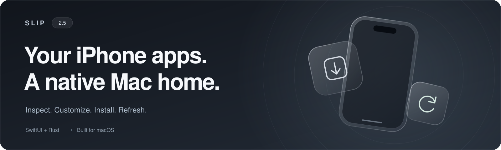
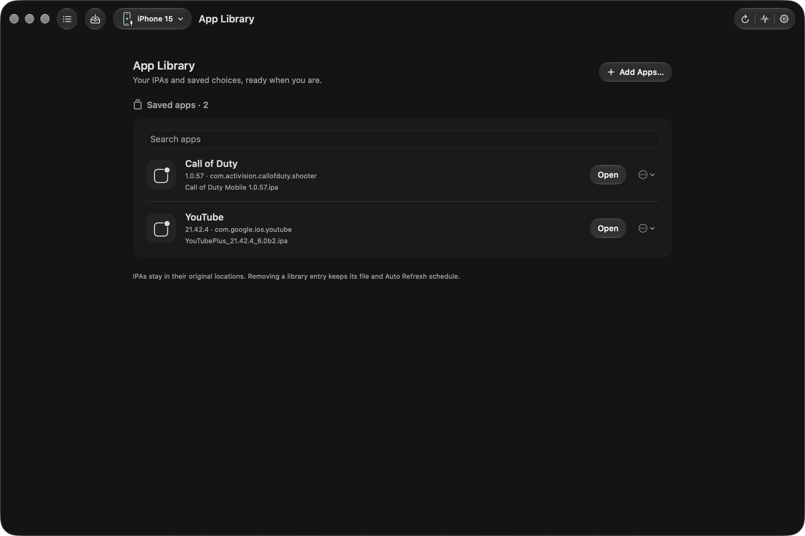
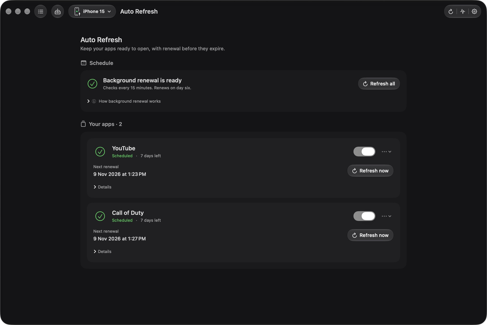
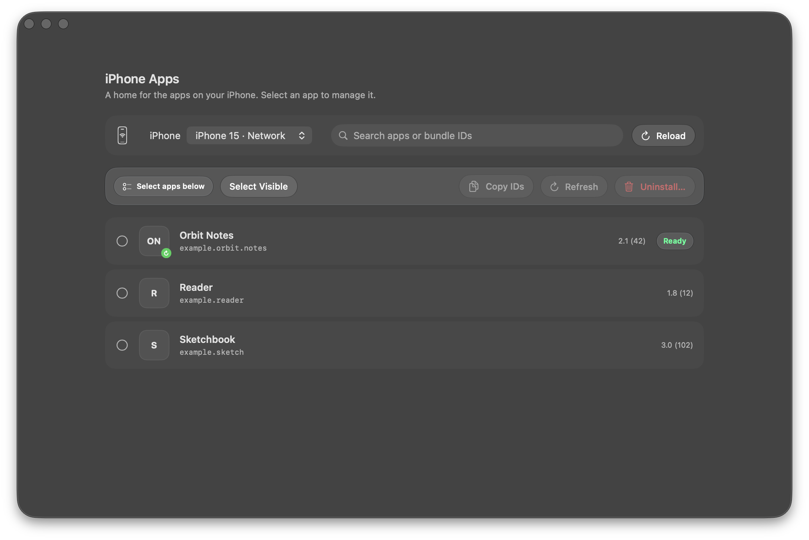
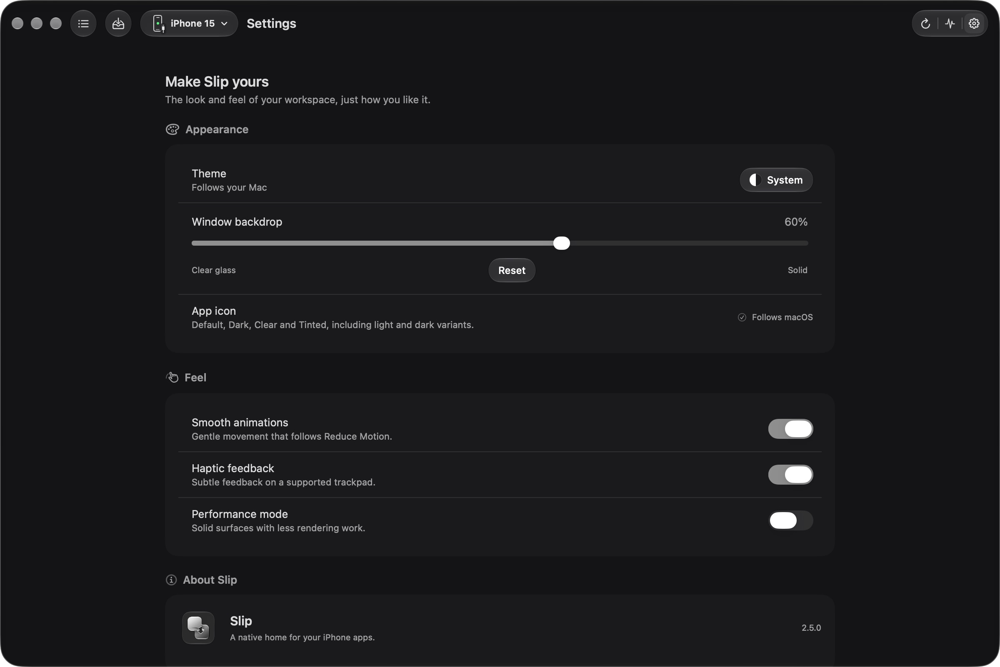
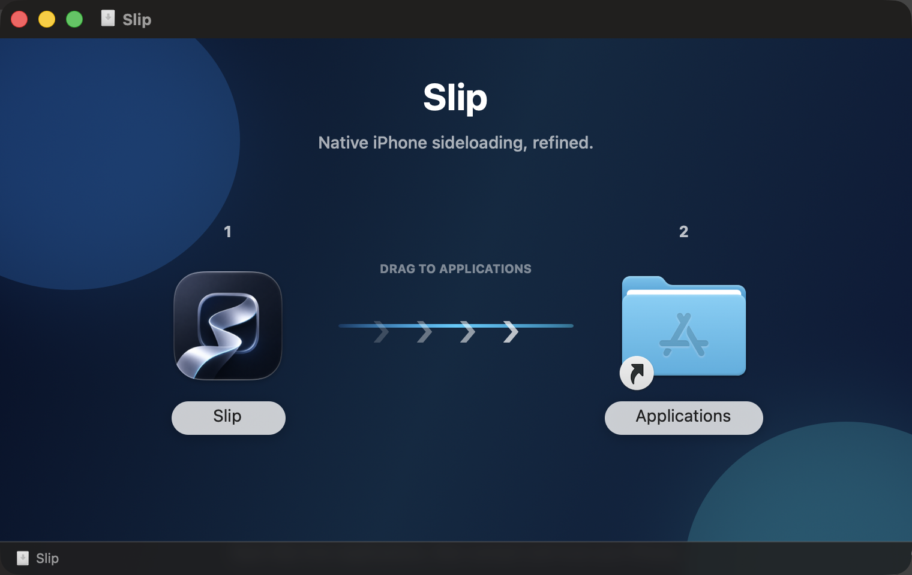

<div align="center">
  
  <p>Inspect, customize, install, and refresh IPAs in a Liquid Glass workspace.</p>
  <p>
    
    
    
  </p>
  <p>
    <a href="https://github.com/therajes/Slip/releases/latest"><strong>Download Slip</strong></a> ·
    <a href="docs/RELEASE_NOTES_2.5.0.md">What’s new in 2.5</a> ·
    <a href="docs/GALLERY.md">Screenshot gallery</a> ·
    <a href="https://github.com/therajes/Slip/tree/main">Source</a>
  </p>
</div>

[](design/media/slip-2.5-demo.mp4)

Slip brings a SwiftUI and AppKit interface together with a Rust core for IPA preparation, Apple signing, and direct iPhone transfer. Save your work in an App Library, review each install, and keep refresh recipes beside the apps they belong to.

**[Watch the 13-second walkthrough →](design/media/slip-2.5-demo.mp4)** · Library search, floating navigation, Auto Refresh, and Settings. Recorded in the native app.

## A workspace for the whole workflow

| Make it yours | Keep it organized | Stay connected |
| :--- | :--- | :--- |
| Drop an IPA or import from Finder or HTTPS. Inspect artwork, identity, versions, extensions, and App ID cost before signing. | Keep saved workspaces in the App Library. Import multiple IPAs and review a sequential installation queue. | Install over USB or a paired local network. Browse the connected iPhone’s apps and manage saved refresh recipes. |
| Change the Home Screen name, bundle ID, icon, minimum iOS version, and supported plist values. Keep or remove individual extensions, or export a customized IPA. | Resume your choices, follow preparation and transfer progress, and find past actions in Activity with privacy redaction. | Refresh Guard can re-sign saved apps about 24 hours before a free profile expires, when the Mac and paired iPhone are reachable. |

<table>
  <tr>
    <td width="50%"><br><strong>Refresh, at a glance</strong><br>Saved recipes and renewal status in one place.</td>
    <td width="50%"><br><strong>A view of your iPhone</strong><br>App inventory, explicit selections, and device actions.</td>
  </tr>
  <tr>
    <td width="50%"><br><strong>Comfortably native</strong><br>Theme and backdrop controls, with system accessibility preferences.</td>
    <td width="50%"><br><strong>Drag. Drop. Open.</strong><br>A familiar macOS installer.</td>
  </tr>
</table>

Library, Auto Refresh, and Settings are captured from 2.5. Device inventory and disk-image images are from earlier releases. Explore the [gallery](docs/GALLERY.md) or [feature matrix](docs/FEATURE_MATRIX.md) for more.

## New in 2.5

This release focuses on a responsive workspace and reliable device state, while retaining saved libraries and renewal times.

- **Quieter autosaving.** Targeted, debounced saves run off the main actor; unchanged snapshots are skipped and newer edits take precedence.
- **Focused progress updates.** Install and download progress update their controls without invalidating the whole workspace.
- **Reusable artwork.** Background decoding, bounded image caches, and lazy library rows reduce repeated work.
- **Device-specific actions.** Stale inventory responses are discarded. Selections, uninstall confirmations, and renewal cleanup stay tied to the intended iPhone.
- **Connection-aware discovery.** USB events, app activation, and waking the Mac trigger discovery; network polling pauses in the background.

Read the [2.5 release notes](docs/RELEASE_NOTES_2.5.0.md) for implementation details, data preservation, and validation boundaries.

## Get started

**You’ll need:** an Apple-silicon Mac running macOS 26 or newer, a personal iPhone, an Apple Account, and an IPA you are authorized to use.

1. [Download the latest available `Slip-*.dmg`](https://github.com/therajes/Slip/releases/latest) and drag Slip to **Applications**.
2. Connect the iPhone over USB, trust the Mac, and enable **Developer Mode** on the iPhone.
3. Add your Apple Account. Password storage in macOS Keychain is optional; unattended Refresh Guard requires it.
4. Drop an IPA into Slip, review its details and customizations, then select **Sign & Install**.

For Wi-Fi discovery, Finder must first recognize the paired iPhone, and both devices must share a normal local network. Personal Hotspot routing can prevent peer discovery. Slip supports `slip://install?url=…` for direct IPA links.

### Refresh Guard and free accounts

Apple Personal Team profiles expire after seven days, and stock iOS limits free accounts to three active sideloaded apps. Slip works within those limits. Refresh Guard performs a normal re-sign and reinstall; the Mac must be awake, the saved IPA and opted-in Keychain credentials available, and the paired iPhone reachable over Wi-Fi or USB.

Slip targets personal iPhones. Apple TV, Apple-silicon Mac app installation, jailbroken-device workflows, and permanent signing are outside its scope.

## Build from source

The native release uses **Xcode 27.2 / macOS SDK 27.2**, with a **macOS 26** deployment target. Install Xcode command-line tools and Rust on an Apple-silicon Mac, then run:

```sh
./native/build.sh
./native/create-dmg.sh native/build/Slip.app native/dist/Slip-2.5.0.dmg
```

For the native architecture and development details, see [native/README.md](native/README.md).

<details>
<summary>Development checks</summary>

```sh
cd src-tauri
cargo fmt --check
cargo check --no-default-features --bin sideloom-core
cargo test --no-default-features --lib
cd ../native
swift build -c debug
swift test
```

</details>

## Privacy and security

Signing, customization, and device communication happen locally, apart from requests to Apple developer services and the configured anisette service. Slip has no analytics or account server. Passwords reach the bundled core through an anonymous stdin pipe, never command arguments or logs; Keychain storage requires explicit consent.

Apple Account profiles support verified names, local avatars, and two-factor prompts that remain visible during developer-session setup. “This Mac” never silently switches authentication providers. Remote compatibility requires an explicitly selected HTTPS endpoint, and local authentication can be unavailable on newer macOS versions. Read [authentication reliability and current limits](docs/AUTHENTICATION_RELIABILITY.md).

Preflight checks reject encrypted IPAs, incompatible iOS targets, invalid bundle IDs, missing icons, duplicate keys, and unsafe identity overrides before signing. Only install or modify apps you are authorized to use. See [SECURITY.md](SECURITY.md) to report a sensitive issue.

## Credits and license

Slip is an independent continuation built on the MIT-licensed foundations of [iLoader](https://github.com/nab138/iloader), [isideload](https://github.com/nab138/isideload), and [idevice](https://github.com/jkcoxson/idevice). It does not contain or redistribute Sideloadly code, assets, branding, or paid-service mechanisms.

The native interface includes modified window and glass UI code from **Droppy Code by Jordy Spruit (Droppy), https://getdroppycode.app** ([project website](https://getdroppycode.app)), Copyright (c) 2026 Jordy Spruit (Droppy). Slip's adaptation is modified and is not affiliated with or endorsed by Droppy or Jordy Spruit. Slip retains its own name, icon, and branding.

The combined native application incorporating that UI is available under GNU AGPL version 3 with Droppy Code's additional attribution, origin, and trademark terms; see [native/LICENSE](native/LICENSE) and the preserved [third-party notices](native/THIRD_PARTY_NOTICES.md). The original MIT-licensed Slip/iLoader code and Rust core retain their existing copyright and [MIT license notices](LICENSE), including Copyright (c) 2025 nab138. This does not replace those original notices or claim ownership of upstream code.

The corresponding source and build scripts are included in this repository. Distributing a build requires providing its corresponding source and notices under the applicable license terms. The app bundles its license texts and displays attribution in About Slip.

Original iLoader branding terms remain documented in [LICENSE-BRANDING](LICENSE-BRANDING). Slip is not affiliated with Apple, Sideloadly, or the iLoader maintainers.
