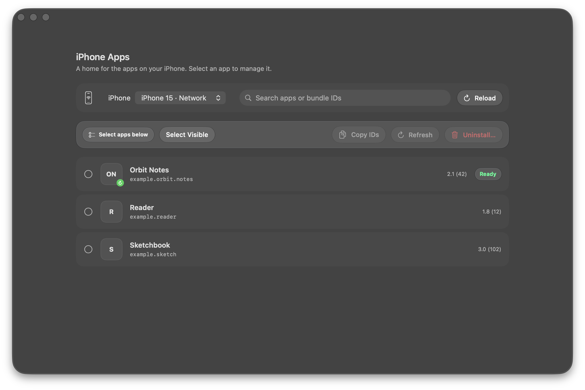
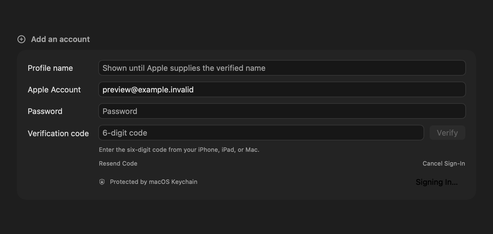
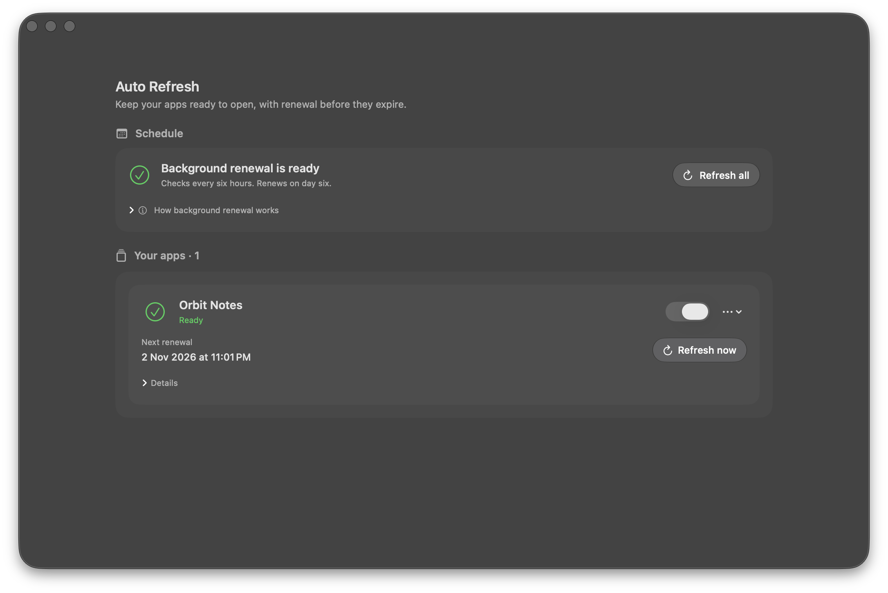
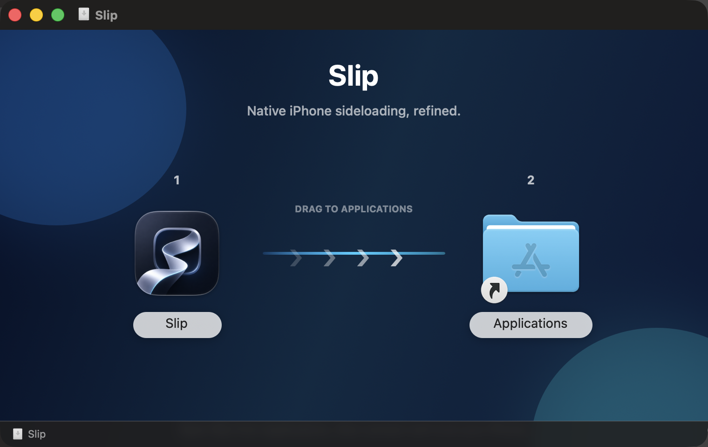

# Slip 2.4.0 Visual Showcase

Slip 2.4.0 pairs Apple's native Liquid Glass interface system with a high-performance Rust core, providing a focused macOS home for installing and managing apps on personal iPhones.

---

## Application Icon & Identity

### Feature Callouts
- **Dual Flowing App Tiles**: Refined graphite and cool platinum gradient palette with a satin finish.
- **Transparent Cutout**: True alpha transparency through the center transfer arrow and outer boundary allows the desktop or Dock to show through.
- **Adaptive System Styling**: Layered macOS 27 Icon Composer asset (`SlipIcon.icon`) providing Aqua, Dark Aqua, and Tintable image stacks.

---

## Liquid Glass Workspace & Installer

### Feature Callouts
- **Liquid Glass Backdrop**: Native SwiftUI and AppKit material layers with a 26-point rounded mask, subtle scrim, and floating navigation capsules.
- **Hardware-Accurate Device Preview**: Dynamic Island, notch, and screen proportions rendered from trusted hardware metadata of the connected iPhone.
- **IPA Inspection & Customization**: Embedded artwork extraction, bundle ID and app title customization, minimum iOS version override, and extension cost calculator.
- **Floating Action Dock**: Contextual **Sign & Install** button, preflight readiness disclosures, and fast App Library queue integration.

---

## Local Apple Account Profiles

### Feature Callouts
- **Verified Developer Profiles**: Apple Developer authentication with verified account names, local custom avatars, and multi-account switching.
- **Secure Keychain Storage**: Opt-in macOS Keychain storage ensuring developer credentials are never logged or exposed in command arguments.
- **Identity & Anisette Status**: Real-time status for local "This Mac" hardware identity (AOSKit) and remote authentication fallback.
- **Refresh Guard Integration**: Backs the automated 7-day profile renewal workflow for connected or network-paired devices.

---

## Auto Refresh Management

### Feature Callouts
- **Automated Profile Renewal**: Background daemon monitors 7-day Apple Personal Team provisioning expirations and automatically re-signs apps over Wi-Fi or USB.
- **Recipe Health Indicators**: Clear status tracking for each managed app with next-refresh schedule, days remaining, and expiration timelines.
- **Kernel File Leasing**: Safe background serialization prevents concurrency conflicts during active device installations.

---

## On-Device App Inventory

### Feature Callouts
- **Live SpringBoard Artwork**: Displays actual on-device app icons loaded directly via Apple MobileDevice framework.
- **Batch Selection & Management**: Select, copy bundle IDs, refresh provisioning, or cleanly uninstall apps and their Auto Refresh recipes in one click.

---

## Drag-to-Applications Disk Image

### Feature Callouts
- **Native Installer Canvas**: Tailored disk image window guiding installation directly into `/Applications`.
- **Self-Contained Bundle**: Fully integrated Swift/Rust native macOS app requiring no third-party mobile drivers or external frameworks.
- **Clean Distribution**: Hardened runtime and signed disk image for seamless macOS gatekeeper compliance.
