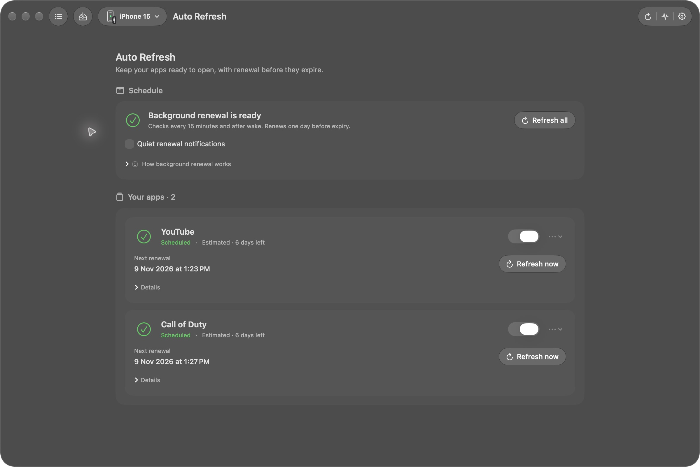
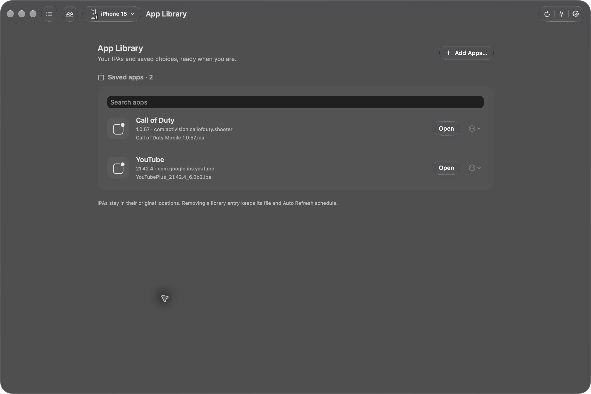
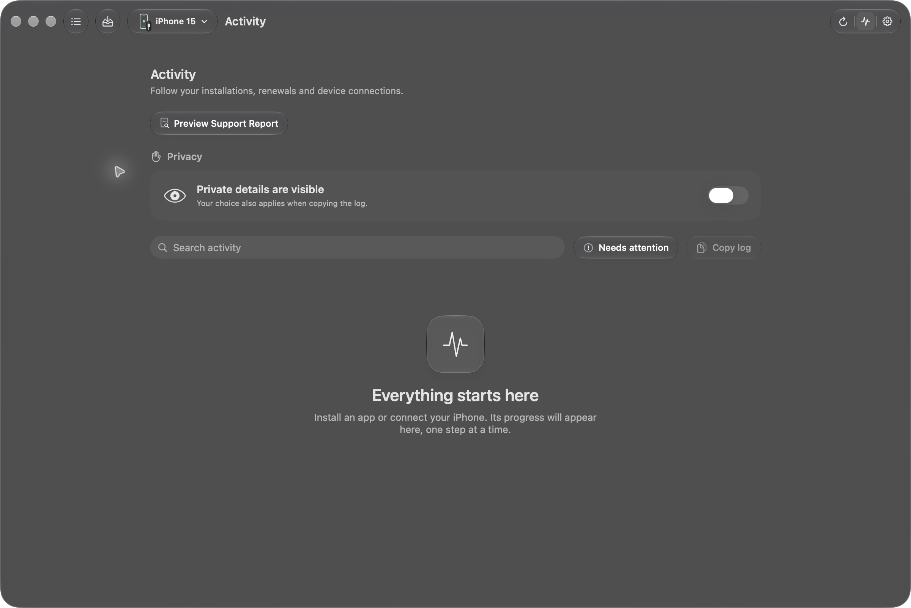
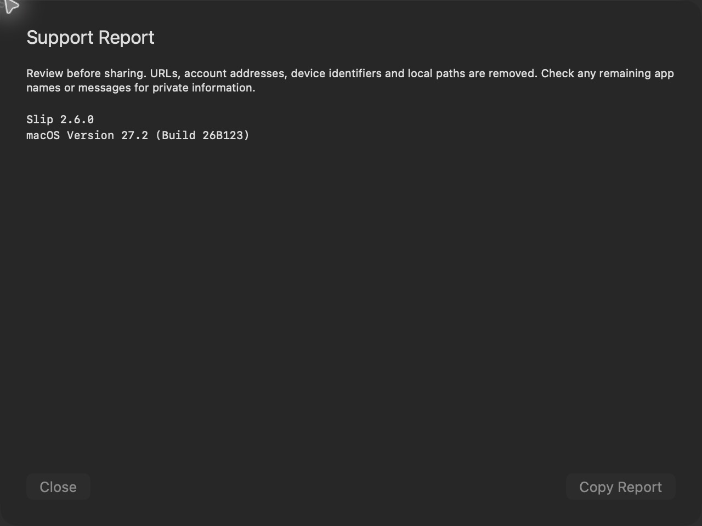
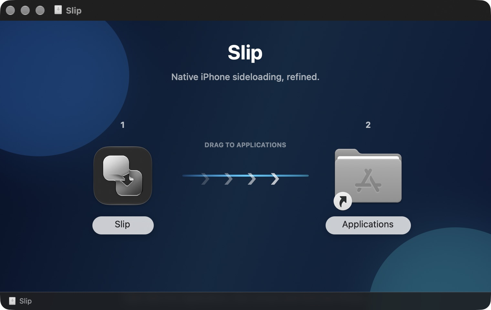

# Slip screenshots

[Download Slip](https://github.com/therajes/Slip/releases/latest) · [What's new in 2.6](RELEASE_NOTES_2.6.0.md) · [Overview](../README.md)

These screenshots were captured from the installed native Slip 2.6.0 app. No Apple sign-in, signing or renewal was performed for the screenshots.

## Renewal deadlines and wake recovery

Legacy deadlines are labeled Estimated. Quiet notifications are optional. Existing recipes and renewal dates are preserved.

## App Library

Saved IPA workspaces retain their choices and original source locations.

## Activity and support

Reports are previewed before copying and always apply redaction independently of Activity's privacy toggle.

## Installer

## Earlier walkthrough

[The 2.5 native navigation demo](../design/media/slip-2.5-demo.mp4) shows the previous release's library search, floating navigation, Auto Refresh and Settings. It does not demonstrate signing or installation.

The inventory image above is retained from an earlier release.
