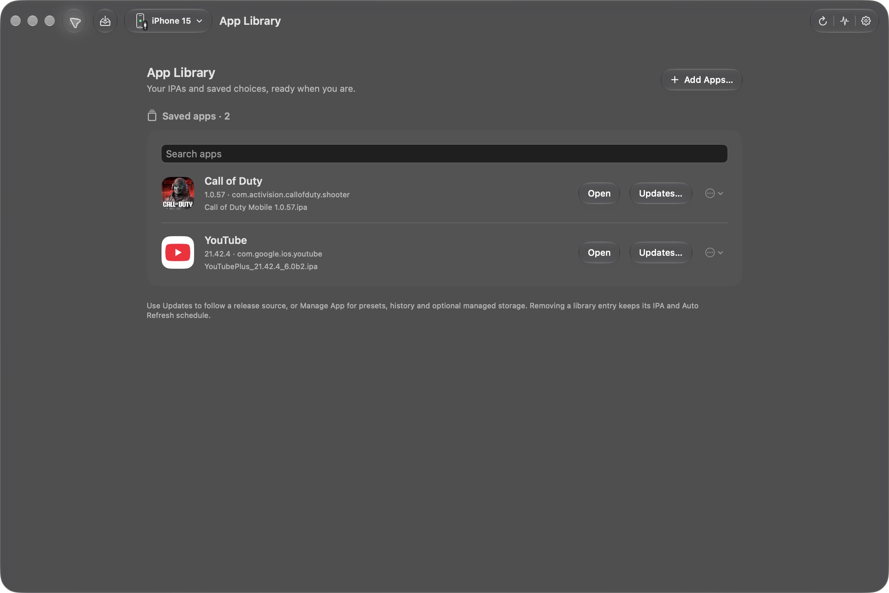
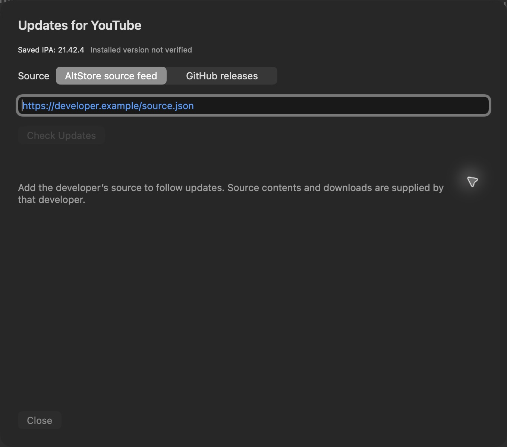
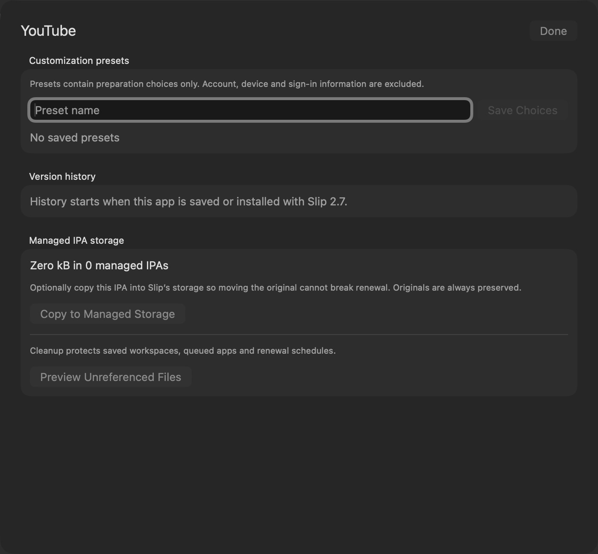

# Slip screenshots

[Download Slip](https://github.com/therajes/Slip/releases/latest) · [What's new in 2.7](RELEASE_NOTES_2.7.0.md) · [Overview](../README.md)

Captured from the installed native Slip 2.7.0 app. No Apple sign-in, signing or device renewal was performed for these screenshots.

## App Library

## Update sources

Add a developer's GitHub repository or AltStore source URL. The initial state explicitly distinguishes the saved IPA from an unverified installed version.

## Presets, history and storage

Existing apps start without invented installation history. Managed storage is optional.

## Renewal and installer

The renewal and installer images above are retained from 2.6; 2.7 preserves that visual style.

[Earlier 2.5 native navigation demo](../design/media/slip-2.5-demo.mp4)
